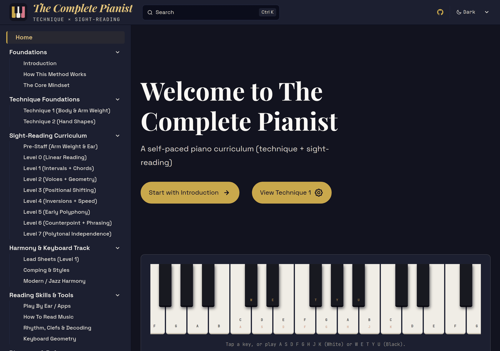
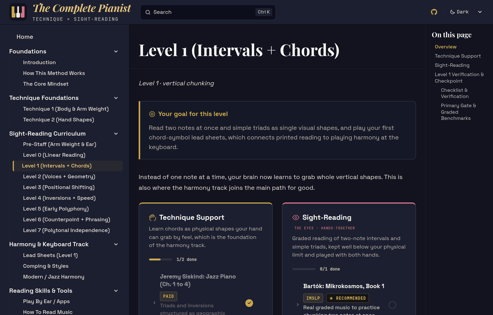
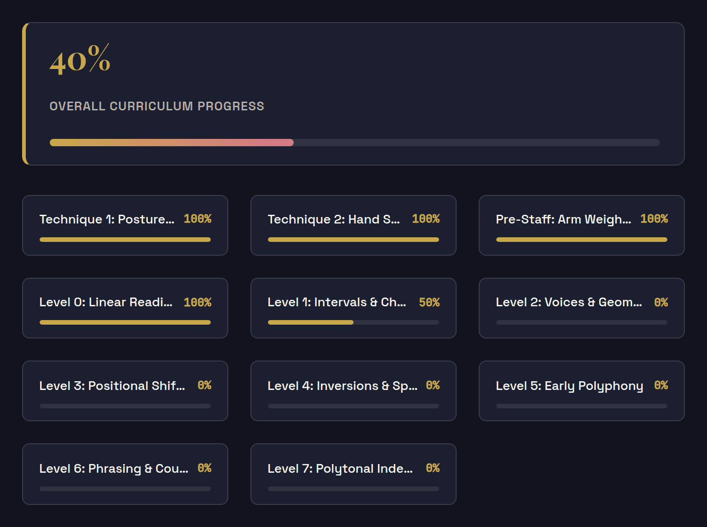
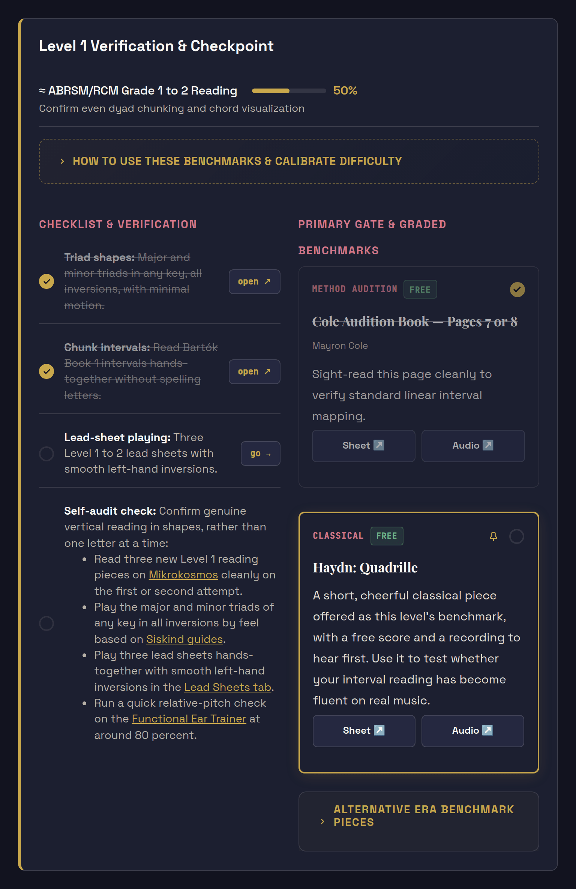
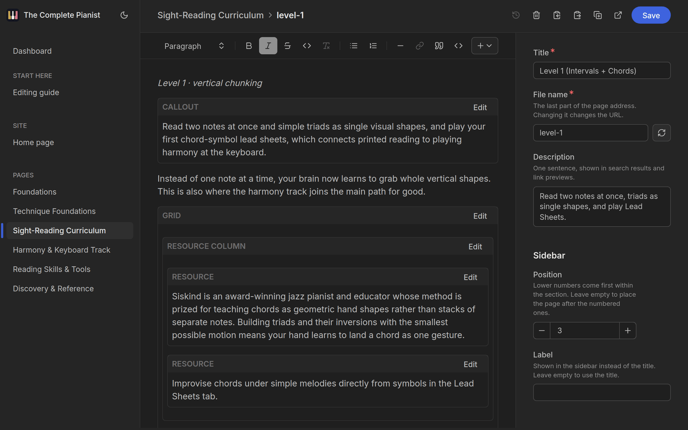

<div align="center">


# The Complete Pianist

**A free, self-paced path for teaching yourself piano.**<br>
Relaxed technique first, then sight-reading, level by level.

[](https://piano-guide.delfost.workers.dev)
[](https://piano-guide.delfost.workers.dev/foundations/introduction/)
[](https://piano-guide.delfost.workers.dev/reference/contributing/)

[](https://piano-guide.delfost.workers.dev)

[](https://github.com/rotero08/PianoGuide/commits/main)

[](https://astro.build)
[](https://starlight.astro.build)
[](https://mdxjs.com)
[](https://www.typescriptlang.org)
[](https://keystatic.com)
[](https://developers.cloudflare.com/workers/)
[](https://pnpm.io)

<br>

<a href="https://piano-guide.delfost.workers.dev"></a>

</div>

## What it is

Self-taught players rarely stall for lack of effort. They stall because the advice they collect never forms a sequence. The Complete Pianist puts it in order: relaxed technique first, then sight-reading once the hands are calm, with the two growing side by side.

It is a shortlist, not a catalogue. Each step names the few books, scores and videos that experienced players and teachers recommend most, says what to do with them, and tells you how to know when you are done.

## What it does

### Gives you a path

Two technique stages, then Pre-Staff and Levels 0 to 7 of sight-reading. Every level sets a goal and pairs a technique column with a reading column. A harmony track (lead sheets, comping, jazz harmony) branches off along the way, and separate pages cover reading music, rhythm, keyboard geometry and playing by ear.



### Keeps track of where you are

Tick off tasks and resources as you finish them. Each level shows its percentage and the introduction shows the whole curriculum. Your progress is saved in your own browser, so there is no account to create.



### Lets you check yourself, your way

Every level ends with a checklist and benchmark pieces to sight-read. Choose the piece you want to be measured by, keep the others as alternatives, and swap in a different method book when the suggested one does not suit you.



### Shows its sources

Claims about how learning and the body work cite numbered studies, collected in the site's reference library along with the pages that rely on each one.

## Free

The Complete Pianist is free and always will be: no account, no paywall. The resources it points to are labelled, so you can see which are free and which cost money.

## Help improve it

Every page ends with an **Edit page** link that opens it in an editor in your browser. You change the page like a document, and your change is sent for review as a pull request. All it takes is a GitHub account. The [Contributing page](https://piano-guide.delfost.workers.dev/reference/contributing/) walks through it.



## Run it yourself

```sh
corepack pnpm install
corepack pnpm dev
```

The site is built with [Astro](https://astro.build) and [Starlight](https://starlight.astro.build), written in MDX, edited through [Keystatic](https://keystatic.com) and hosted on [Cloudflare Workers](https://developers.cloudflare.com/workers/).

## Credits

The curriculum grew out of the *Quick Music/Sight-Reading Resource Chart* by MrScarletOnTheMoon and out of what the people of r/piano and its neighbouring communities recommend again and again. The [Credits page](https://piano-guide.delfost.workers.dev/reference/credits/) has the details.
